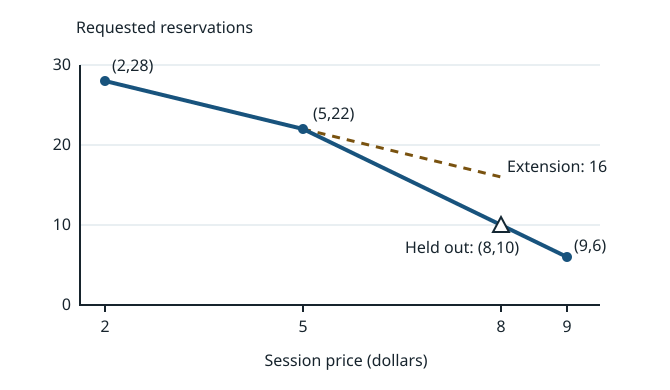

# 5. Building and challenging models

*The line fits. The next question is where.*

Imagine the studio has records of requested reservations at three distinct advertised session prices. Treat the counts as fictional observations, not as measurements from a live market. The studio needs a transparent forecast within the measured price window, not a formula for all possible prices.

**By the end:** fit a piecewise line, use an excluded observation as a challenge, and turn a numerical recommendation into a conditional one.

| Price $p$ (dollars) | Requested reservations |
| ---: | ---: |
| 2 | 28 |
| 5 | 22 |
| 9 | 6 |

## Construct a rule that changes rate

From 2 to 5, slope is $(22-28)/(5-2)=-2$ reservations per dollar. Putting $(2,28)$ into $D=mp+b$ sets $b=32$. From 5 to 9, slope is $(6-22)/(9-5)=-4$ and intercept is 42. Choose the first rule on $2\le p\le5$ and the second on $5<p\le9$. They both give 22 at the join. The split does not count that price twice. Notice how this design fits the observations exactly, but does not tell us whether demand really has a corner at 5 dollars. We chose straight pieces as an interpolation rule.

Read the chart by fixing a price on the horizontal axis and moving up to a modeled number of reservations on the vertical axis. The triangle is a challenge observation, withheld while choosing the rules. The dashed line is not part of the accepted model.

## Try to make it fail

The second segment predicts 10 at 8 dollars. The first segment extended alone predicts 16. The withheld observation is 10, so in this check the two residuals (observed minus predicted) are 0 and −6, respectively. One held-out point is useful evidence against the first-segment extension, but is not a general accuracy result. A single straight line through the two endpoints could also be considered; at 8 dollars it predicts $28-22(8-2)/7=64/7\approx9.14$. That fit has a smaller modeling burden and different errors, including at the 5-dollar fitting point. Make the selection criterion explicit rather than picking a winner from one convenient number.

At 12 dollars the second formula, applied outside its interval, returns −6. A negative reservation count is an exposed failure of extrapolation. Setting it to zero would be a **new** rule, not evidence about demand at 12 dollars. The chart describes expected or modeled counts between prices; decide whether to round or not before comparing with a discrete capacity.

## Use capacity without pretending to know the mix

Suppose whole-dollar prices are permitted, all modeled requests must fit and the studio can allocate four extended slots with the rest standard. Chapter 4 proved a 19-reservation maximum under those conditions. At every whole-dollar price from 2 through 5 the model predicts more than 19. At 6 dollars it gives 18, with a feasible split of $(14,4)$ using 40 minutes. This is the lowest whole-dollar price within the model that meets the capacity goal, not a claim about revenue maximization or an actual market. If eight of the 18 are extended, then setup is $2(18)+8=44$, so the 6-dollar recommendation does not survive that new assumption.

## Demonstrate the model unaided

1. Draw both segments, mark the join and label the slope of each.
2. Defend one model against the held-out count and record the 12-dollar failure.
3. Find one feasible price and split and show the setup calculation.

If you request an AI counterproposal, require it to give an equation, domain, fit rule and one counterexample. Check its claims against the original table by hand. A partner with the paper challenge provides the same check. Keep your first graph, residuals and the changed recommendation in your revision note. [Worksheet](../practice/worksheet.md) · [Teaching sequence and grading](../teaching/README.md)
